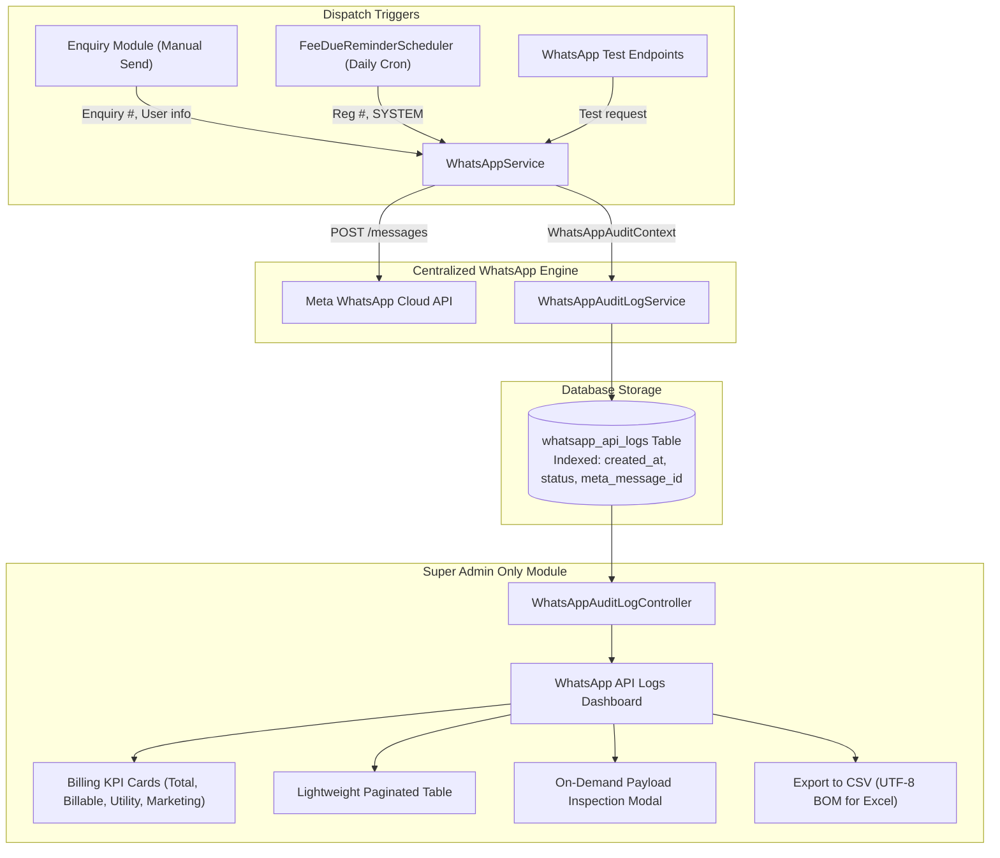

# Implementation Plan: WhatsApp API Audit Logs & Billing Reconciliation Module

> **Target Audience**: `SUPER_ADMIN` only  
> **Key Objective**: Comprehensive audit trail of all WhatsApp API dispatches (Course Information & Fee Reminders) and exact billing reconciliation against Meta Cloud API invoices.

---

## 1. Overview & Business Requirements

### A. The Need
1. **User Accountability**: Identify exactly which employee/counselor triggered a WhatsApp course brochure from the Enquiry module, when (exact date & timestamp), to which student, and with which attached document.
2. **Automated Scheduler Visibility**: Track all automated fee due reminder WhatsApp messages dispatched by the 11:00 AM daily cron scheduler, including installment numbers and due amounts.
3. **Meta Billing & Financial Reconciliation**: Meta WhatsApp Cloud API charges per delivered conversation/utility template. The accounts department needs an exact count of billable message IDs (`wamid`) and category breakdown (`UTILITY` vs `MARKETING`) to reconcile with Meta's monthly invoice.
4. **Security & Access Control**: This module must be **strictly accessible only to the `SUPER_ADMIN` role**. Other roles (Admin, Counselor, Accountant, Staff) must have zero access or visibility.

---

## 2. Technical Architecture & Component Design



---

## 3. Crucial Architecture Refinements (Identified During Deep Audit)

1. **Rich Context Propagation (`WhatsAppAuditContext`)**:
   * Previously, `executeMetaTemplateCall` in `WhatsAppService` only received `useCase` and `referenceId`.
   * **Refinement**: Pass a dedicated `WhatsAppAuditContext` carrying `moduleType`, `templateName`, `triggerType`, `triggeredByUsername`, `triggeredByEmployeeName`, `referenceId`, `referenceNumber` (Enquiry No / Reg No), `studentName`, `recipientMobile`, `courseName`, and `attachmentName`.
   * Automatically resolves current logged-in user from Spring Security `SecurityContextHolder` when triggered from web requests, or defaults to `"SYSTEM"` / `"System Scheduler"` for cron jobs.

2. **Accurate Meta Billing Reconciliation Categories**:
   * Meta invoices break down costs by conversation category:
     * `crm_fee_reminder_utility` $\rightarrow$ **`UTILITY`**
     * `crm_course_information` $\rightarrow$ **`MARKETING`**
   * Capture both the category and the exact **Meta Message ID (`wamid`)** from `messages[0].id` in the API response.

3. **Performance & Memory Optimization**:
   * Heavy raw JSON payloads (`request_payload` and `response_payload`) are mapped with `columnDefinition = "TEXT"`.
   * The paginated list endpoint returns a lightweight DTO (`WhatsAppAuditLogSummaryDTO`) to ensure fast page loads even with 100,000+ logs.
   * Full payloads are fetched on demand only when the Super Admin clicks "Inspect Payload / View Details".

4. **Fail-Safe Transaction Decoupling**:
   * Audit logging executes with `Propagation.REQUIRES_NEW` inside a `try-catch` block.
   * A logging error will **never** roll back an enquiry save or disrupt the fee reminder scheduler countdown.

5. **Exact Thymeleaf & Security Alignment**:
   * Aligned with the repository's established Super Admin check:
     ```html
     th:if="${currentUser != null && ((currentUser.employee != null && currentUser.employee.role != null && currentUser.employee.role.roleTitle == 'SUPER_ADMIN') || (currentUser.role != null && currentUser.role.roleTitle == 'SUPER_ADMIN'))}"
     ```
   * Enforced with `@PreAuthorize("hasRole('SUPER_ADMIN')")` across all API and page controller endpoints.

6. **Excel-Compatible CSV Export**:
   * Encoded with UTF-8 BOM (`\uFEFF`) to ensure Indian rupee symbols (₹), student names, and dates open properly in Microsoft Excel without character corruption.

---

## 4. File-by-File Implementation Breakdown

### Phase 1: Database Model & Repository
* **`sms/src/main/java/com/tts/sms/model/WhatsAppAuditLog.java`**:
  * Fields: `id`, `moduleType`, `templateName`, `billingCategory` (`UTILITY`/`MARKETING`), `triggerType`, `triggeredByUsername`, `triggeredByEmployeeName`, `referenceId`, `referenceNumber`, `studentName`, `recipientMobile`, `courseName`, `attachmentName`, `status` (`SUCCESS`/`FAILED`/`BLOCKED`), `metaMessageId`, `failureReason`, `httpStatusCode`, `requestPayload`, `responsePayload`, `createdAt`.
  * Indexes: `created_at`, `module_type`, `status`, `recipient_mobile`, `meta_message_id`.

* **`sms/src/main/java/com/tts/sms/dto/WhatsAppAuditContext.java`**:
  * Clean context container DTO passed from dispatchers.

* **`sms/src/main/java/com/tts/sms/dto/WhatsAppAuditLogSummaryDTO.java`**:
  * Lightweight summary projection for high-speed table rendering.

* **`sms/src/main/java/com/tts/sms/repository/WhatsAppAuditLogRepository.java`**:
  * Filtered pagination queries & KPI aggregation counts.

---

### Phase 2: Service Layer & Centralized Interception
* **`sms/src/main/java/com/tts/sms/service/WhatsAppAuditLogService.java`**:
  * `logEvent(WhatsAppAuditContext, WhatsAppSendResult, ...)`
  * `getLogsWithFilters(...)`
  * `getKpiStats(...)`
  * `exportToCsv(...)`
* **`sms/src/main/java/com/tts/sms/service/WhatsAppService.java`**:
  * Hook `WhatsAppAuditLogService.logEvent` in `executeMetaTemplateCall` and in all early exits (disabled, invalid number, blocked).
* **`sms/src/main/java/com/tts/sms/service/EnquiryService.java`**:
  * Pass user and enquiry metadata into WhatsApp call.
* **`sms/src/main/java/com/tts/sms/scheduler/FeeDueReminderScheduler.java`**:
  * Pass registration number and `SYSTEM` context into fee reminder dispatch.

---

### Phase 3: Super Admin Controllers
* **`sms/src/main/java/com/tts/sms/controller/WhatsAppAuditLogController.java`**:
  * `@RequestMapping("/api/whatsapp-logs")`
  * `@PreAuthorize("hasRole('SUPER_ADMIN')")`
  * REST endpoints for paginated logs, KPI statistics, single log inspection, and CSV download.
* **`sms/src/main/java/com/tts/sms/controller/WhatsAppAuditLogPageController.java`**:
  * `@RequestMapping("/reports/whatsapp-api-logs")`
  * `@PreAuthorize("hasRole('SUPER_ADMIN')")`
  * Serves the dashboard view.

---

### Phase 4: UI Dashboard & Layout Integration
* **`sms/src/main/resources/templates/reports/whatsapp-api-logs.html`**:
  * Premium dashboard matching CRM theme:
    * 4 Top KPI Cards (Total Calls, Billable Success, Utility Count, Marketing Count).
    * Filter bar (Date range, Module, Status, Search).
    * Table with status badges, copyable Meta IDs, and "Inspect" button.
    * Modal for JSON payload review.
* **`sms/src/main/resources/static/assets/js/whatsapp-logs.js`**:
  * AJAX filtering, pagination, and CSV download handling.
* **`sms/src/main/resources/templates/layout/layout.html`**:
  * Add navigation item under Reports / API Services with Super Admin check.

---

## 5. Verification & Acceptance Checklist

1. **Compilation**: Verify build with `mvn test-compile -DskipTests`.
2. **Access Control**:
   * Login as `SUPER_ADMIN` $\rightarrow$ Module visible, page accessible, API returns 200 OK.
   * Login as other roles $\rightarrow$ Menu hidden, URL access returns 403 Forbidden.
3. **Enquiry Audit**:
   * Send WhatsApp brochure from Enquiry modal $\rightarrow$ Row appears with logged-in user name, enquiry number, and `wamid`.
4. **Fee Reminder Audit**:
   * Trigger 5-day fee reminder countdown $\rightarrow$ Rows appear with `SYSTEM_SCHEDULER`, registration number, and `wamid`.
5. **Blocked Status Audit**:
   * Turn toggle OFF in Settings and attempt to send $\rightarrow$ Row appears with status `BLOCKED` and clear reason.
6. **Billing Tally**:
   * Meta Message ID (`wamid`) and Category (`UTILITY`/`MARKETING`) export cleanly to Excel CSV.
