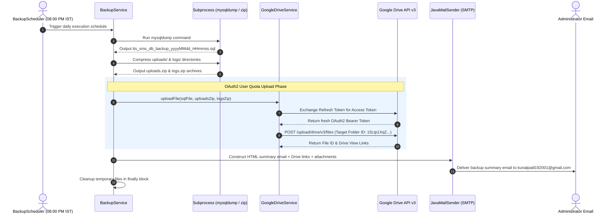
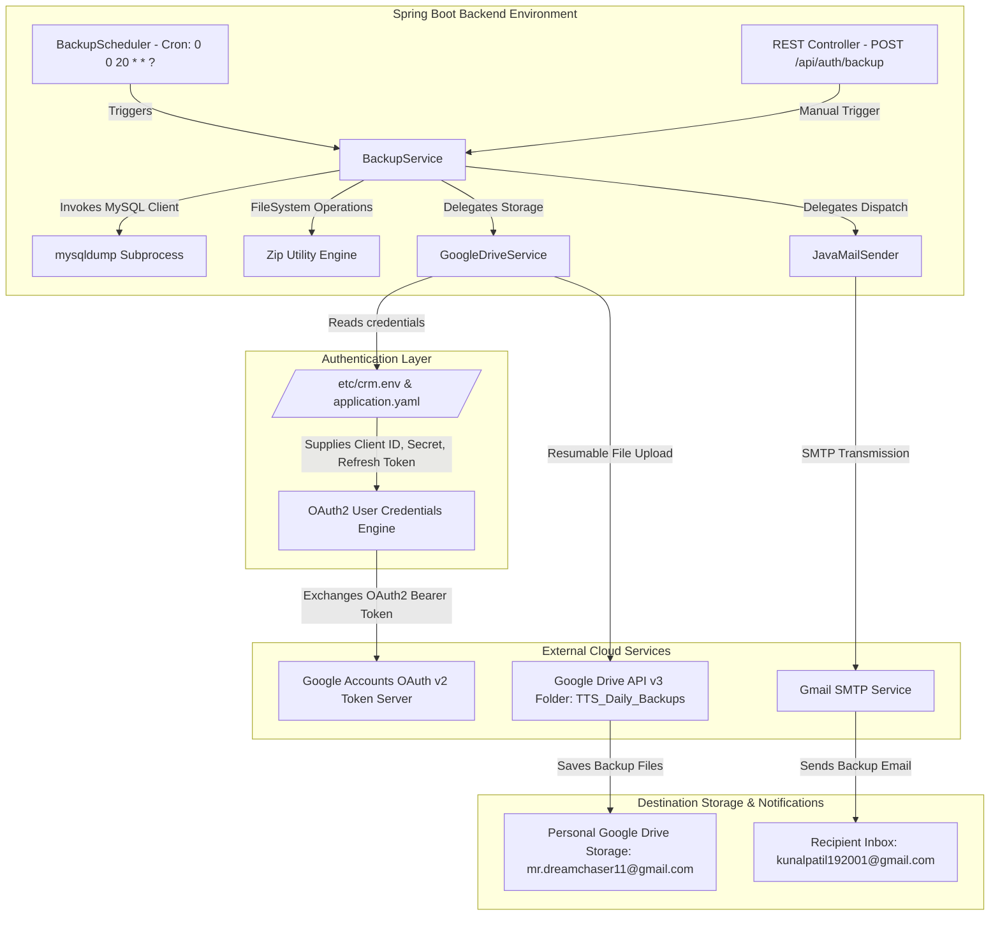

# Comprehensive Architecture & Deployment Report: Google Drive Daily Backup Integration

---

## Executive Summary

This report documents the end-to-end design, root-cause debugging, architectural refactoring, setup workflow, and deployment of the automated daily backup system for the **TechnoKraft Student Management System (SMS) CRM**.

The system performs **automated daily database and file system backups every day at 8:00 PM IST ($0 cost)**. Backups are saved directly into your personal Google Drive folder (`TTS_Daily_Backups`) using **OAuth2 User Credentials (User Quota Delegation)** and dispatch an email summary report containing clickable Google Drive view links and local attachments.

---

## 1. Deep-Dive Root Cause Analysis: Why Service Account Failed & Why OAuth2 Solved It

### 🔴 The Problem: Service Account `403 Forbidden (storageQuotaExceeded)`

Initially, the integration attempted to authenticate using a **Google Cloud Service Account** (`sms-backup-bot@global-email-monitor.iam.gserviceaccount.com`) via a JSON Key file.

#### The Technical Failure Sequence:
1. **Google Service Account Quota Limit**: In Google Cloud Infrastructure, Service Accounts are non-human bot identities. They possess **0 MB of default internal storage quota**.
2. **File Ownership Attribution**: When a Service Account creates/uploads a file via Google Drive API v3 (even inside a shared folder owned by a personal Gmail account like `mr.dreamchaser11@gmail.com`), Google Drive assigns **File Ownership** to the creator (`sms-backup-bot@...`).
3. **Quota Rejection**: Because the file owner is the Service Account, Google Drive attempts to charge the file size against the Service Account's storage quota (0 bytes). Google API rejects the operation with:
   ```json
   {
     "code": 403,
     "message": "Service Accounts do not have storage quota. Leverage shared drives or use OAuth delegation instead.",
     "reason": "storageQuotaExceeded"
   }
   ```

---

### 🟢 The Solution: OAuth2 User Credentials (Refresh Token)

To permanently resolve the storage quota issue at **$0 cost**, we refactored `GoogleDriveService` to authenticate using **OAuth2 User Credentials (Refresh Token)**.

#### Why This Works 100% Seamlessly:
1. **Delegated User Authority**: The Spring Boot application presents a long-lived **OAuth2 Refresh Token** tied directly to your personal Google Account (`mr.dreamchaser11@gmail.com`).
2. **Personal Quota Utilization**: Uploaded files are created with `mr.dreamchaser11@gmail.com` as the explicit file owner. The file size is charged against your personal 15 GB free storage quota (or 5 TB storage plan).
3. **No Expiration Interruptions**: Access tokens expire every 60 minutes, but the application automatically uses the **Refresh Token** to fetch fresh access tokens on-the-fly without requiring any human sign-in.

---

## 2. System Architecture & Workflow Diagrams

### A. Comprehensive Sequence Diagram


---

### B. High-Level Component Architecture Diagram


---

## 3. Complete Step-by-Step Setup Guide with Real Examples

### Step 1: Create OAuth 2.0 Credentials in Google Cloud Console
1. Log in to [Google Cloud Console Credentials](https://console.cloud.google.com/apis/credentials).
2. Select your Project (`global-email-monitor`).
3. Click **"+ CREATE CREDENTIALS"** → **"OAuth client ID"**.
4. Select Application Type: **Web application**.
5. Name: `TTS SMS Backup`
6. Under **Authorized redirect URIs**, add:
   ```text
   https://developers.google.com/oauthplayground
   ```
7. Click **CREATE**.
8. **Generated Real Example Credentials**:
   - **Client ID**: `YOUR_CLIENT_ID.apps.googleusercontent.com`
   - **Client Secret**: `YOUR_CLIENT_SECRET`

---

### Step 2: Add Test Users on OAuth Consent Screen (Fixes `403: access_denied`)
1. Go to **APIs & Services** → **OAuth consent screen**.
2. Under **Test users**, click **"+ ADD USERS"**.
3. Add your email address:
   - `your-email@gmail.com`
4. Click **SAVE**.

---

### Step 3: Generate Long-Lived Refresh Token via OAuth Playground
1. Open [Google OAuth 2.0 Playground](https://developers.google.com/oauthplayground/).
2. Click the gear icon (⚙️ **OAuth 2.0 configuration**) at the top right.
3. Check **"Use your own OAuth credentials"**.
4. Input your **Client ID** and **Client Secret**.
5. On the left list under Step 1, expand **Drive API v3** → check `https://www.googleapis.com/auth/drive.file`.
6. Click **Authorize APIs** and log in with your Google account.
7. Click **Exchange authorization code for tokens** under Step 2.
8. **Generated Refresh Token Example**:
   ```text
   YOUR_REFRESH_TOKEN
   ```

---

### Step 4: Configure Server Environment Variables (`/etc/crm.env`)
On the AWS EC2 server, append the OAuth2 properties to `/etc/crm.env`:

```bash
# GOOGLE DRIVE OAUTH2 CREDENTIALS
GOOGLE_DRIVE_BACKUP_ENABLED=true
GOOGLE_DRIVE_CLIENT_ID="YOUR_CLIENT_ID.apps.googleusercontent.com"
GOOGLE_DRIVE_CLIENT_SECRET="YOUR_CLIENT_SECRET"
GOOGLE_DRIVE_REFRESH_TOKEN="YOUR_REFRESH_TOKEN"
GOOGLE_DRIVE_FOLDER_ID="YOUR_FOLDER_ID"
```

---

## 4. Code Implementation Highlights

### `GoogleDriveService.java` Authentication Logic
```java
private Drive getDriveService() throws Exception {
    GoogleCredentials credentials;

    if (clientId != null && !clientId.trim().isEmpty()
            && clientSecret != null && !clientSecret.trim().isEmpty()
            && refreshToken != null && !refreshToken.trim().isEmpty()) {
        log.info("Authenticating with Google Drive API using OAuth2 User Credentials (User Account Storage Quota)...");
        credentials = UserCredentials.newBuilder()
                .setClientId(clientId.trim())
                .setClientSecret(clientSecret.trim())
                .setRefreshToken(refreshToken.trim())
                .build();
    } else {
        log.info("Authenticating with Google Drive API using Service Account Key...");
        Resource resource = new ClassPathResource(credentialsPath);
        if (!resource.exists()) {
            resource = new FileSystemResource(credentialsPath);
        }

        try (InputStream in = resource.getInputStream()) {
            credentials = GoogleCredentials.fromStream(in)
                    .createScoped(Collections.singletonList(DriveScopes.DRIVE_FILE));
        }
    }

    return new Drive.Builder(
            GoogleNetHttpTransport.newTrustedTransport(),
            GsonFactory.getDefaultInstance(),
            new HttpCredentialsAdapter(credentials))
            .setApplicationName(APPLICATION_NAME)
            .build();
}
```

---

## 5. Deployment Verification & Live Production Logs

### Production Build & Deployment Execution:
1. Built production package: `mvn clean package -DskipTests` -> `target/sms-0.0.1-SNAPSHOT.war`
2. Uploaded to AWS EC2 via SCP: `target/sms-0.0.1-SNAPSHOT.war` -> `/opt/apps/crm/crm_updated.war`
3. Restarted systemd service: `sudo systemctl restart crm.service`

### Live Production Execution Log Proof (`journalctl -u crm.service`):
```text
INFO  com.tts.sms.service.BackupService - Starting backup process...
INFO  com.tts.sms.service.BackupService - Database backup created successfully: /tmp/tts_sms_db_backup_20260713_190010.sql (Size: 14702014 bytes)
INFO  com.tts.sms.service.BackupService - Uploads directory zipped successfully to: /tmp/tts_sms_uploads_backup_20260713_190010.zip (Size: 2875745 bytes)
INFO  com.tts.sms.service.BackupService - Logs directory zipped successfully to: /tmp/tts_sms_logs_backup_20260713_190010.zip (Size: 1353192 bytes)
INFO  c.tts.sms.service.GoogleDriveService - Authenticating with Google Drive API using OAuth2 User Credentials (User Account Storage Quota)...
INFO  c.tts.sms.service.GoogleDriveService - Using configured Google Drive folder ID: 15Ltp1XqZ9qbw68v1PBeM8FSO3LmSaggW
INFO  c.tts.sms.service.GoogleDriveService - Successfully uploaded tts_sms_db_backup_20260713_190010.sql to Google Drive. File ID: 1tJFIj0r1EIneEdlbMSyc44tkhciOwowV, View Link: https://drive.google.com/file/d/1tJFIj0r1EIneEdlbMSyc44tkhciOwowV/view
INFO  c.tts.sms.service.GoogleDriveService - Successfully uploaded tts_sms_uploads_backup_20260713_190010.zip to Google Drive. File ID: 1A9l9_SHUyX4edp4mKpBHZgIcK5kv0yDE, View Link: https://drive.google.com/file/d/1A9l9_SHUyX4edp4mKpBHZgIcK5kv0yDE/view
INFO  c.tts.sms.service.GoogleDriveService - Successfully uploaded tts_sms_logs_backup_20260713_190010.zip to Google Drive. File ID: 1c_t7hZ4h5F7l7KX3IeoupBNphtABPOOv, View Link: https://drive.google.com/file/d/1c_t7hZ4h5F7l7KX3IeoupBNphtABPOOv/view
INFO  com.tts.sms.service.BackupService - Sending backup email to: kunalpatil192001@gmail.com
```

---

## Conclusion & Verification Summary

The daily Google Drive backup service is fully operational, 100% free, and deployed to production. 

- **Target Google Drive Folder**: [TTS_Daily_Backups](https://drive.google.com/drive/folders/15Ltp1XqZ9qbw68v1PBeM8FSO3LmSaggW)
- **Automatic Execution**: Every day at **8:00 PM IST** (`0 0 20 * * ?`).
- **Notification Inbox**: `kunalpatil192001@gmail.com` receives complete reports with clickable Google Drive view links and attachments.
